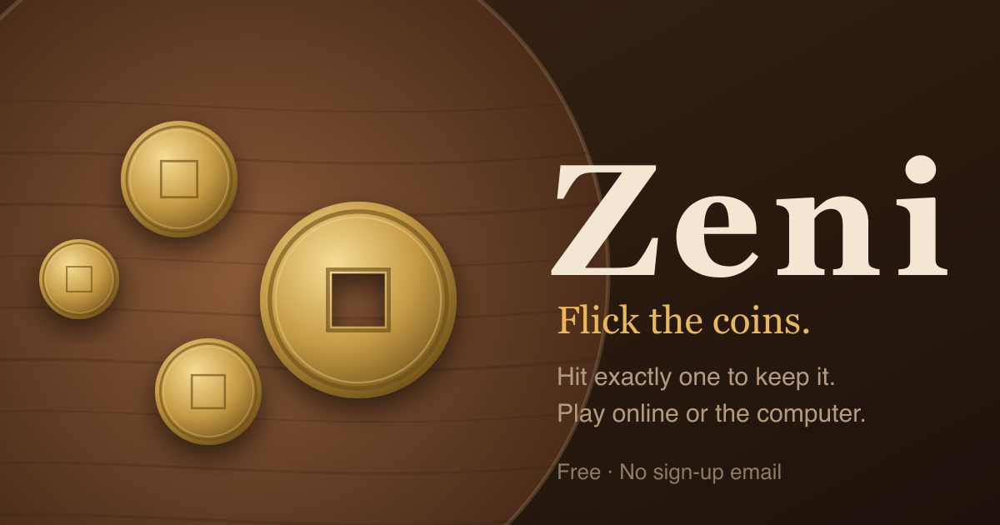

# Zeni



**Flick. Hit one. Keep it.** A coin-flicking game for the browser, based on the traditional Japanese game *zeni hajiki* (銭はじき, "coin flicking"). Play the computer, a friend or someone new, on your phone or computer. It installs like an app and works offline.

**Play now: [zeni.oluwafemicodes.workers.dev](https://zeni.oluwafemicodes.workers.dev)**

## How to play

Coins are scattered on a round table with an open edge. Tea cups sit in the way.

1. On your turn, touch any **free** coin (one that isn't touching another), drag back and let go.
2. Hit **exactly one** other coin and you **keep** it. Then shoot again with the same coin, from where it stopped.
3. Hit none, or two or more, and your turn ends.
4. **Anything that falls off the table goes to your opponent**, and your turn ends.

The game ends when one coin is left, no coin is free, or 40 shots have been taken. Most coins wins.

## Features

- **Play the computer** at three levels (Beginner, Skilled, Master), offline.
- **Online play:** Quick Match against someone at your level, or a friend with a room code or link. Rated games, a global leaderboard and six tiers from Amateur to Legend.
- **Challenges:** challenge players you've met, and see who challenged you on the home screen.
- **Daily puzzle:** the same table for everyone each day. Keep as many coins as you can in three turns, then share your score.
- **Best of 3**, two tables (Easy with 4 cups, Hard with 7) and places you unlock as you climb.
- A 3D table, characters with their own reactions, sounds and haptics.
- A short interactive tutorial.
- No email or password: you get a player code to sign in on another device.

## How it's built

| Part | Built with |
|---|---|
| Game | TypeScript, three.js for the table, plain DOM and CSS for menus |
| Physics and rules | Deterministic simulation in `shared/`, run identically by the browser and the server |
| Server | Cloudflare Workers, with one Durable Object per game room, the Quick Match queue and the online count |
| Database | Cloudflare D1 (players, ratings, matches, challenges) |
| App | Installable PWA with `vite-plugin-pwa` |
| Build and tests | Vite and Vitest |

The server plays every shot itself, so results can't be faked by a modified client.

```
client/      the game in the browser: screens, 3D table, input, sound
shared/      rules, physics, computer player, ratings, protocol
server/      Worker, Durable Objects (Room, Matchmaker, Presence), API
migrations/  D1 database schema
tools/       simulators, online test bots, asset generators
public/      icons, sounds, privacy page, headers
```

## Run it locally

Needs Node 22 (see `.nvmrc`).

```bash
npm ci
npx wrangler d1 migrations apply zeni --local
npm run dev
```

Then open http://localhost:5173. The Worker, Durable Objects and a local database all run inside the dev server.

### Useful scripts

| Command | What it does |
|---|---|
| `npm test` | Run the unit tests |
| `npm run typecheck` | Check types for the client, server and tools |
| `npm run build` | Typecheck and build for production |
| `npm run simulate` | Play many computer-vs-computer games to check balance |
| `npm run play-online` | End-to-end test of online play against a running dev server |

## Deploying

Pushing to `main` deploys to production through Cloudflare Workers Builds. Apply new database migrations to production before merging:

```bash
npx wrangler d1 migrations apply zeni --remote
```

## Credits

- Sound effects from [Kenney](https://kenney.nl) (CC0): Impact Sounds, Casino Audio and RPG Audio.
- Based on *zeni hajiki*, a traditional Japanese children's game.
